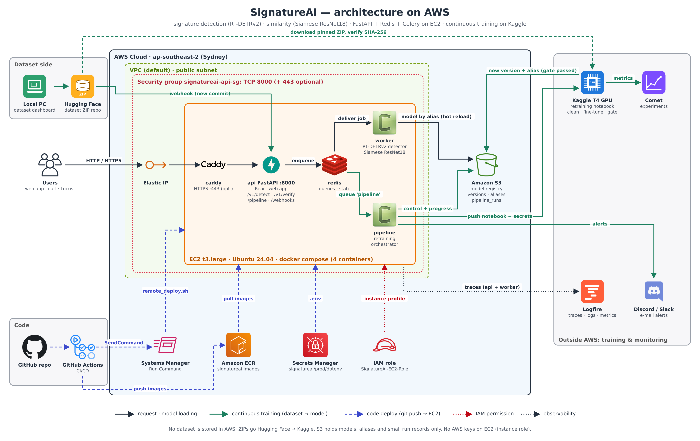

# SignatureAI — signature detection, similarity and MLOps

End-to-end system that finds signatures in document images (RT-DETRv2, Apache-2.0, **no Ultralytics**),
scores signature similarity (Siamese ResNet18), serves both through **FastAPI + Redis + Celery** on AWS EC2,
and retrains automatically on a Kaggle GPU when the Hugging Face dataset changes.
Experiments are tracked in **Comet**, models are versioned in **Amazon S3**, logs and traces go to **Logfire**.

**Live:** web app <http://13.236.244.226:8000/> (Detect, Verify, Pipeline) · API docs <http://13.236.244.226:8000/docs>

## Two automated flows, and nothing else

| Flow | Trigger | Runs where | What it changes |
|---|---|---|---|
| **Code deploy (CI/CD)** | `git push` to `main` | GitHub Actions (tests) → EC2 via AWS SSM (`docker compose` rebuild) | the **code** on EC2 |
| **Retraining (continuous training)** | new dataset ZIP on Hugging Face (webhook) | EC2 `pipeline` container → Kaggle T4 GPU | the **model** (S3 alias → workers hot-reload) |

GitHub Actions never trains a model, and the retraining never touches the code.

```
 CODE   git push ──▶ GitHub Actions: tests + Docker builds ──AWS SSM──▶ EC2: git reset --hard <sha> → docker compose up

 MODEL  dataset dashboard ──ZIP──▶ Hugging Face dataset ──webhook──▶ EC2 API /webhooks/huggingface ──▶ Redis "pipeline"
                                                                            │
                     EC2 pipeline worker: new ZIP? already trained? ──▶ Kaggle T4: clean → fine-tune → eval (Comet)
                                                                            │
                     S3 versions/<v>/artifact.zip + manifest ◀── validation gate passed? ──▶ aliases/latest.json
                                                                            │ hot reload
 SERVE  client ──HTTP──▶ FastAPI (EC2) ──job──▶ Redis ──▶ Celery workers (RT-DETRv2 + Siamese ResNet18) ──▶ result
                           └── Logfire traces: request → queue wait → inference
```



Diagrams of every flow: [`docs/architecture/`](docs/architecture/README.md).

## Repository layout

```
.
├── .github/workflows/ci-cd.yml     CI (tests, checks, Docker builds) + CD to EC2. The only workflow.
├── signature_service/              Everything that runs on EC2
│   ├── app/                        FastAPI API, Celery inference tasks, retraining orchestrator, webhooks
│   ├── web/                        React web app: Detect (/), Verify (/verify), Pipeline dashboard (/pipeline)
│   ├── docker/                     api / worker / pipeline Dockerfiles
│   ├── docker-compose.yml          redis + api + worker + pipeline (+ optional Caddy HTTPS)
│   ├── deploy/                     EC2 user data, remote_deploy.sh (run by CD), IAM policies, Caddyfile
│   ├── loadtest/                   Locust stress test
│   ├── scripts/                    cold-start measurement
│   ├── tests/                      pytest (end-to-end with real Redis + Celery, registry, webhooks, orchestrator)
│   └── .env.example                server configuration template (.env itself is never committed)
├── pipeline/                       Retraining job that runs on Kaggle
│   ├── train_pipeline.ipynb        generated from notebooks/01 by make_pipeline_notebook.py (CI checks it is in sync)
│   ├── kaggle_job.py               builds/pushes the Kaggle kernel, creates the Kaggle secrets dataset
│   └── mock/                       CPU mock tests of the notebook and of the whole orchestrator
├── notebooks/                      Research / first training runs
│   ├── 01_detection_training_colab.ipynb        HF download → cleaning + leakage gate → RT-DETRv2 → Comet → S3
│   │                                            (source of pipeline/train_pipeline.ipynb: do not rename)
│   ├── 03_similarity_same_dataset_kaggle.ipynb  Siamese ResNet18 on the same signature corpus + similarity gate → S3
│   └── archive/                                 earlier versions, kept for history
│       ├── 01_detection_training_colab_v1_before_fixes.ipynb
│       └── 02_similarity_siamese_cedar_kaggle.ipynb (+ .py)   Phase 7: SSIM vs ResNet18 vs Siamese on CEDAR
├── infra/aws/                      Everything AWS as code: IAM policy templates, trust policy, ECR lifecycle,
│                                   setup_aws.sh (bucket, ECR, IAM role/users, secret, EC2) for a new account
├── dataset_dashboard/              Local dataset review tool (Node.js): import, fix boxes, export, publish ZIP to HF
├── START_DASHBOARD.bat             starts the dataset dashboard on Windows
└── docs/
    ├── PROJECT_STATUS.md           requirement checklist: what is done, what is still open
    ├── architecture/               diagrams (aws/ = AWS-icon diagrams, the rest = flow diagrams)
    ├── setup/                      how to set things up (new AWS account, CI/CD secrets, EC2, retraining, promotion)
    ├── results/                    measured results per phase
    └── images/                     screenshots (see docs/images/README.md)
```

**Not in git (by design):** datasets (`Dataset/`, on Hugging Face), model weights (S3), `.env` files and keys,
`infra/aws/aws.env` and `infra/aws/out/` (account IDs, access keys), dashboard working data (`.signature-dashboard/`),
`node_modules/`.

## Documentation

| I want to… | Read |
|---|---|
| see what is finished and what is still open | [`docs/PROJECT_STATUS.md`](docs/PROJECT_STATUS.md) |
| move the project to **another AWS account** (every IAM user, role, policy, step by step) | [`docs/setup/aws_new_account_setup.md`](docs/setup/aws_new_account_setup.md) |
| see the system on AWS | [`docs/architecture/aws/aws_architecture.png`](docs/architecture/aws/aws_architecture.png) |
| make every `git push` deploy to EC2 (GitHub secrets, SSM, IAM) | [`docs/setup/cicd_github_secrets.md`](docs/setup/cicd_github_secrets.md) |
| create the EC2 server from zero | [`docs/setup/deploy_ec2.md`](docs/setup/deploy_ec2.md) |
| set up retraining (HF webhook → EC2 → Kaggle) | [`docs/setup/retraining_pipeline.md`](docs/setup/retraining_pipeline.md) |
| use the web app, the API, run locally, load test | [`signature_service/README.md`](signature_service/README.md) |
| use the dataset dashboard | [`dataset_dashboard/README.md`](dataset_dashboard/README.md) |
| see measured results | [`docs/results/`](docs/results/) |

## Key results
* **Detection** (run `v20261109T142002Z-8a4d7444`): 28,958 images (22,953 / 3,287 / 2,718 train / val / test),
  leakage gate passed. Held-out test mAP@50 **0.807**, mAP@[.5:.95] 0.554.
* **Similarity** (Siamese ResNet18, CEDAR, writer-disjoint): test EER **5.0 %**, AUC 0.99
  ([`docs/results/phase7_similarity_results.md`](docs/results/phase7_similarity_results.md)).
* **Queue on EC2 t3.large**: 20 simultaneous jobs, 20/20 succeeded, 0.93 images/s
  ([`docs/results/phase5_6_ec2_queue_results.md`](docs/results/phase5_6_ec2_queue_results.md)).
