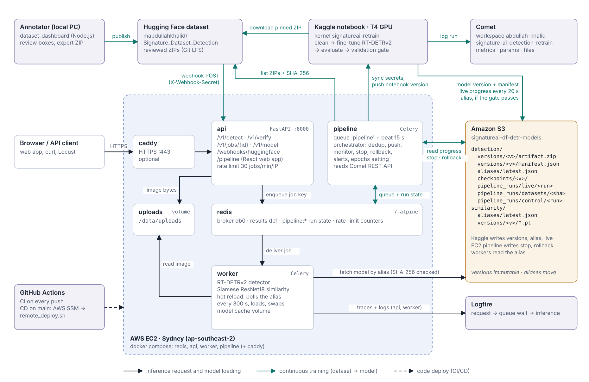
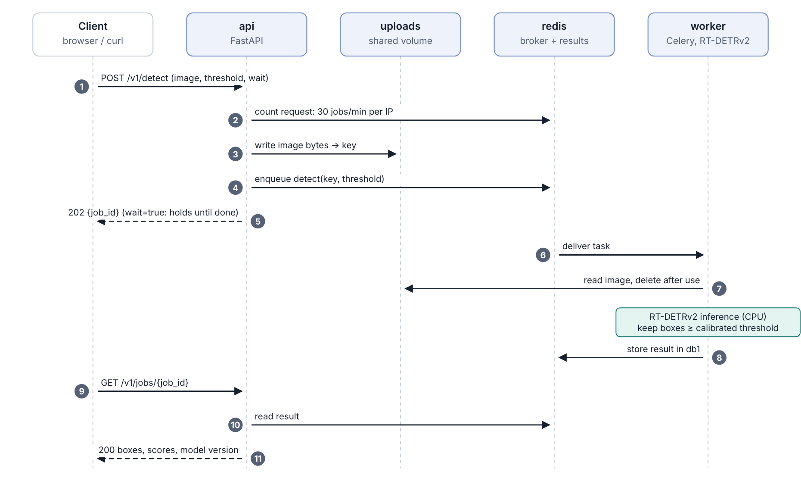
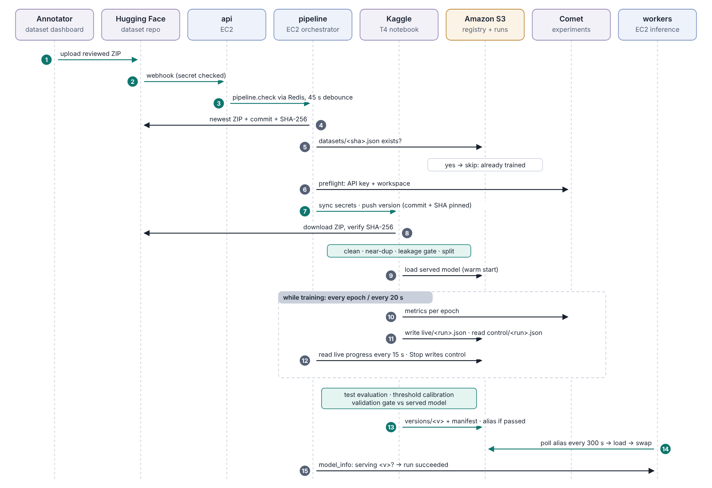
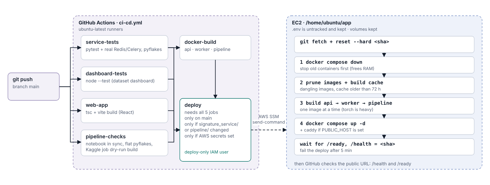
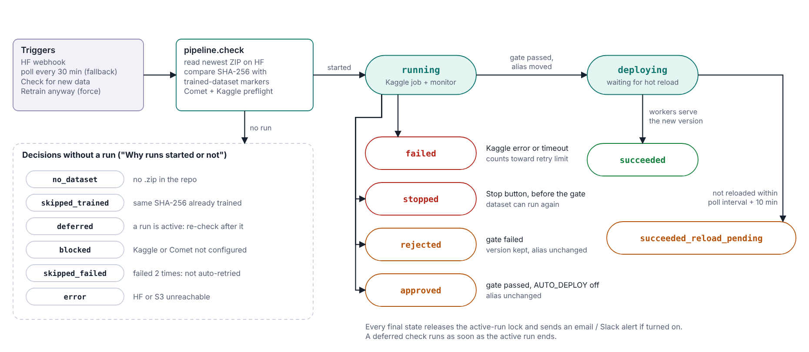
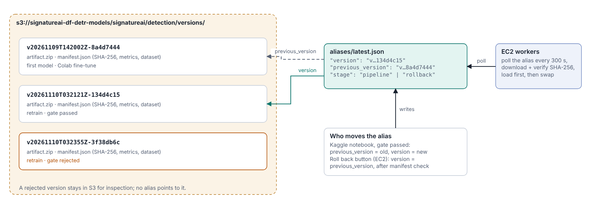
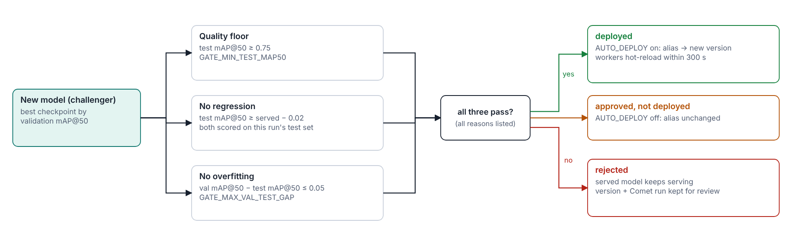
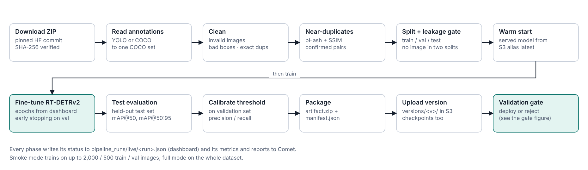

# Architecture diagrams

Drawn from the code at commit `f804f75` (`signature_service/`, `pipeline/`, `.github/workflows/ci-cd.yml`).
Times are the defaults in `signature_service/.env.example`. Each picture has an SVG version in [`svg/`](svg/).

Two flows change the system: **CI/CD** changes the code, **continuous training** changes the model.

| # | Diagram | Shows |
|---|---|---|
| 1 | [System architecture](#1-system-architecture) | containers on EC2, S3, Hugging Face, Kaggle, Comet, Logfire, GitHub Actions |
| 2 | [Detection request](#2-detection-request) | one `POST /v1/detect` from upload to result |
| 3 | [Continuous training](#3-continuous-training) | dataset upload → Kaggle training → gate → hot reload |
| 4 | [CI/CD](#4-cicd) | `git push` → tests → deploy on EC2 through AWS SSM |
| 5 | [Run lifecycle](#5-run-lifecycle) | decisions and final states of a retraining run |
| 6 | [Model registry and roll back](#6-model-registry-and-roll-back) | versions, the `latest` alias, `previous_version` |
| 7 | [Validation gate](#7-validation-gate) | the three checks that decide deployment |
| 8 | [Training notebook](#8-training-notebook-on-kaggle) | the twelve phases on Kaggle |

## 1. System architecture


* The EC2 instance runs four containers from one `docker-compose.yml`. Only `api` is reachable from outside (port 8000, or 443 through Caddy).
* Images never go through Redis: the API writes them to a shared volume and queues only a small key.
* The model reaches the workers only through S3. Kaggle writes a version and moves the alias; each worker polls the alias and hot-reloads.
* No dataset is stored in AWS. Kaggle downloads the ZIP straight from Hugging Face at a pinned commit.

## 2. Detection request


* The client gets a job id at once, or the result directly with `wait=true`.
* The worker deletes the image after use. `/v1/verify` follows the same path with two images and the Siamese ResNet18 model.

## 3. Continuous training


* Step 5 is the duplicate check on the SHA-256 of the ZIP content: a re-upload under a new name does not train again.
* Step 6 fails fast when the Comet key or workspace is wrong, before any GPU time is used.
* Steps 10 to 12 repeat while the model trains: Comet gets the metrics, the dashboard gets the live progress, and Stop works through the control file.
* The run is marked succeeded only after a worker reports that it serves the new version (step 15).

## 4. CI/CD


* Deploy runs only when all five jobs pass, on `main`, when `signature_service/` or `pipeline/` changed.
* GitHub reaches EC2 through AWS SSM with a deploy-only IAM user: no SSH key is stored in GitHub.
* Containers stop before the build and images build one at a time, so the small instance does not run out of memory.

## 5. Run lifecycle


* The left list is what the dashboard shows under "Why runs started or not".
* `failed` counts toward the auto-retry limit of 2; `stopped` does not, and the dataset stays untrained so it can run again.

## 6. Model registry and roll back


* The gate writes the new version and keeps the old one as `previous_version`.
* Roll back swaps them back after checking that the target's manifest exists; workers switch at their next poll.

## 7. Validation gate


* Both models are scored on the same test set of this run, so a changed dataset cannot make the comparison unfair.
* The gap check catches overfitting: a model much better on validation than on unseen test images is rejected.

## 8. Training notebook on Kaggle


* The split keeps exact and near-duplicate images in one split only, so test scores are not inflated by leakage.
* Training starts from the served model (fine-tune), with the epoch limit from the dashboard and early stopping on validation mAP@50.

## Editing the diagrams
The pictures are generated from [`src/diagrams.py`](src/diagrams.py) (plain Python, no packages):
```bash
cd docs/architecture/src
python diagrams.py ../build        # writes ../build/svg/*.svg
```
Copy the SVGs you changed into `svg/`. To refresh a PNG, open the SVG in a browser and take a screenshot, or use any SVG-to-PNG tool.
